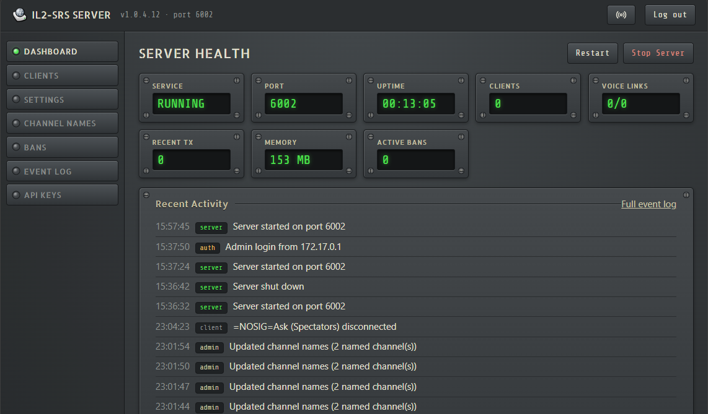

# IL2-SRS Server (web)

The IL2-SRS server as a .NET 10 application with a browser-based admin UI and a REST API. It runs in
Docker or directly on Windows (console or Windows service), and is wire-compatible with existing IL2-SRS
clients. It replaces the WPF server window; the WPF server stays in the repository until this one has
been proven in production.



What it adds over the WPF server:

- Admin UI in the browser: health, clients (mute, kick, ban), settings, channel names, bans, event log and API keys.
  Times are shown in each viewer's own time zone; the **Desktop / Light / Dark / IL-2 SRS** button in the
  top bar switches the theme (Desktop follows the system setting; IL-2 SRS matches the client's grey
  equipment panels) and is remembered per browser.
- SQLite database (`srs.db`) for settings, channel names, bans with reason and expiry, the event log and API keys.
- Settings can be fixed from the environment (`SRS_<SETTING>`); they are then locked in the UI.
- Live event log of logins, admin actions, server start/stop, client connections, name and coalition changes and
  radio retuning. Every event has a type (e.g. `client.connected`) and a JSON payload; automatic retention.
- Plugins add pages, API endpoints and event handling without changing the server. See [Plugins](#plugins).
- Integrations (a plugin, included in the image): run an action when an event happens, optionally only when the
  event data matches conditions (for example only Red pilots). Runs are queued, kept across restarts, retried if
  configured and listed under **Runs** on the Integrations page. Built-in actions: **Post to Discord** (webhook, plain message or
  card) and **Send an HTTP request** (any URL, e.g. Slack or Teams webhooks). See [Integrations](#integrations).
- REST API with read and write API keys, described by an OpenAPI document and browsable in the
  Scalar API reference at `/scalar`.
- Published image: [`asken/il2-srs-server`](https://hub.docker.com/r/asken/il2-srs-server) with a built-in Docker health check.

## Data directory

Everything the server writes lives in one folder: `/data` in the container, otherwise the folder given
with `--data-dir` or `SRS_DATA_DIR`. Without either, the application folder is used; on Windows, if that
folder is not writable (for example under `C:\Program Files`), `C:\ProgramData\IL2-SRS-Server` is used
instead. The first log line shows which folder is in use.

| File | Purpose |
| --- | --- |
| `srs.db` | Settings, channel names, bans, event log, API keys (SQLite, WAL mode) |
| `srs-server.json` | Optional configuration file with the same `SRS_*` keys as the environment |
| `serverlog.txt` | Full server log (also written to the console) |
| `keys/` | Keys that protect the admin login cookie and encrypt integration secrets (back it up with `srs.db`) |
| `plugins/` | Plugins to load, one folder each (see [Plugins](#plugins)) |
| `plugin-data/<id>/` | Each plugin's own data, e.g. `plugin-data/integrations/integrations.db` |
| `clients-list.json` | Client export, when **Auto Export List** is on |

On first start, an existing `server.cfg` and `banned.txt` from the WPF server in the data directory are
imported into `srs.db` (`-cfg=<file>` imports another file). The files are not changed or used afterwards.

Use a local disk or a Docker named volume for the data directory. SQLite should not be placed on a
network share (SMB/NFS).

## Configuration

Configuration keys can be set as environment variables, command-line arguments (`--KEY=value`) or in
`srs-server.json` in the data directory.

| Key | Default | Meaning |
| --- | --- | --- |
| `SRS_ADMIN_PASSWORD` | – | Admin UI password, at least 8 characters. Required. |
| `SRS_ADMIN_PASSWORD_FILE` | – | Read the password from a file instead (Docker secrets). |
| `SRS_ADMIN_AUTH_DISABLED` | `false` | Run the admin UI without a password. Only when access is restricted another way. |
| `SRS_<SETTING>` | – | Fix a server setting, e.g. `SRS_SERVER_PORT=6002`, `SRS_COALITION_AUDIO_SECURITY=true`. Locked in the UI. |
| `SRS_EVENT_RETENTION_DAYS` | `30` | Delete events older than this. |
| `SRS_EVENT_MAX_ROWS` | `100000` | Keep at most this many events. |
| `SRS_DATA_DIR` | app folder | Data directory (same as `--data-dir`). `/data` in the container. |
| `urls` / `ASPNETCORE_URLS` | `http://localhost:8080` | Admin UI address. The container listens on port 8080 on all interfaces. |

Server setting names are those of `server.cfg` (`SERVER_PORT`, `COALITION_AUDIO_SECURITY`,
`SPECTATORS_AUDIO_DISABLED`, `IRL_RADIO_TX`, `RADIO_COLLISION_EFFECTS`, `SECOND_RADIO_ENABLED`,
`CHANNEL_LIMIT`, `GLOBAL_LOBBY_FREQUENCIES`, `PRIORITY_TRANSMITTER_NAMES`, `SHOW_TUNED_COUNT`,
`SHOW_TRANSMITTER_NAME`, `SHOW_SQUAD_CHANNEL_LABELS`, `CLIENT_EXPORT_ENABLED`, `CLIENT_EXPORT_FILE_PATH`,
`ASSIGNED_CALLSIGNS_JSON_FILE`), plus `SERVER_NAME` and `PUBLIC_ADMIN_URL` for integration messages.
Relative file paths are inside the data directory.

## Docker

The image is published as [`asken/il2-srs-server`](https://hub.docker.com/r/asken/il2-srs-server)
(tags `preview` and `<version>-preview`, amd64).

```sh
docker run -d --name il2-srs-server --restart unless-stopped \
  -e SRS_ADMIN_PASSWORD='a-long-password' \
  -p 6002:6002/tcp -p 6002:6002/udp -p 127.0.0.1:8080:8080 \
  -v il2-srs-data:/data asken/il2-srs-server:preview
```

Or with the compose file in this folder (set `SRS_ADMIN_PASSWORD` in the shell or in a `.env` file next to it):

```sh
docker compose -f IL2-SRS-Server-Web/docker-compose.yml up -d
```

### Build from source

```sh
# From the repository root
docker build -f IL2-SRS-Server-Web/Dockerfile -t il2-srs-server .
```

Then use `il2-srs-server` as the image name in the commands above.

### Publishing the image

`scripts/Publish-DockerImage.ps1` builds the image from the current commit (refusing uncommitted
changes), pushes `<version>-preview` and `preview` to Docker Hub, and updates the Docker Hub short
description and overview from [`DOCKERHUB.md`](DOCKERHUB.md). It uses your `docker login` for both.
Editing the Hub page needs an access token with **Read, Write, Delete** access; if your `docker login`
token has less, set `DOCKERHUB_TOKEN` to such a token (also the way to run it in CI).
Use `-Suffix '' -Channel latest` for a release. The repository category can only be set on the Docker Hub website.

### Notes

- Publish the SRS port for **both TCP and UDP**. If you change it with `SRS_SERVER_PORT`, change the published ports too.
- The admin UI is plain HTTP on port 8080. Keep it on localhost, or put a reverse proxy with HTTPS
  (Caddy, Traefik, nginx) in front before exposing it.
- To run several servers, run several containers with their own volume and ports.
- The image has a health check: `docker ps` shows the container as `healthy` while both SRS listeners
  are running, and `unhealthy` if one fails or an admin stops the server from the UI. The same check is
  available as `GET /healthz` (`200 ok` or `503`) for other monitoring.
- The container runs as a non-root user. If you bind-mount a host folder instead of a named volume,
  it must be writable by UID 1654.

## Windows

Publish a self-contained build (no .NET installation needed on the server):

```powershell
dotnet publish IL2-SRS-Server-Web -c Release -r win-x64 --self-contained -o C:\IL2-SRS\app
```

Run it in a console (without `--data-dir`, see [Data directory](#data-directory)):

```powershell
$env:SRS_ADMIN_PASSWORD = 'a-long-password'
C:\IL2-SRS\app\IL2-SRS-Server.exe --data-dir C:\IL2-SRS\main
```

Or install it as a Windows service from an elevated PowerShell prompt. The script writes
`srs-server.json` (readable only by Administrators and SYSTEM), adds firewall rules for the SRS port
and starts the service:

```powershell
C:\IL2-SRS\app\Install-WindowsService.ps1 -DataDirectory C:\IL2-SRS\main
```

Manage it with `Get-Service IL2-SRS-Server`, `Restart-Service IL2-SRS-Server`, or `sc.exe`. Remove it
with `Stop-Service IL2-SRS-Server; sc.exe delete IL2-SRS-Server`. Without the script:

```bat
sc.exe create IL2-SRS-Server binPath= "\"C:\IL2-SRS\app\IL2-SRS-Server.exe\" --data-dir \"C:\IL2-SRS\main\"" start= auto
```

and put `SRS_ADMIN_PASSWORD` in `C:\IL2-SRS\main\srs-server.json`:

```json
{ "SRS_ADMIN_PASSWORD": "a-long-password", "urls": "http://localhost:8080" }
```

Limitations on Windows: UPnP port forwarding (`UPNP_ENABLED`) is not supported; forward the port on
the router. The service writes its log to `serverlog.txt` in the data directory, not to the Windows
event log.

## API

Create keys under **API Keys** in the admin UI and send them as `Authorization: Bearer <key>` (or
`X-Api-Key: <key>`). Read keys can use every `GET`; write keys can use everything. Keys cannot create
other keys.

- **API reference:** `/scalar`, for logged-in admins and linked from the **API Keys** page. Paste a key
  into its authentication field to try requests from the browser.
- **OpenAPI document:** `/openapi/v1.json`, public, for code generators and scripts.

| Method and path | Scope | Purpose |
| --- | --- | --- |
| `GET /api/v1/status` | read | Health, port, uptime, client counts |
| `GET /api/v1/clients` | read | Connected clients |
| `POST /api/v1/clients/{guid}/kick` | write | Disconnect a client |
| `POST /api/v1/clients/{guid}/ban` | write | Ban and disconnect; body `{ "reason": "...", "durationMinutes": 60 }` |
| `POST /api/v1/clients/{guid}/mute`, `/unmute` | write | Server-side mute |
| `GET /api/v1/settings` | read | All settings, with source and lock state |
| `PUT /api/v1/settings/{key}` | write | Change a setting; body `{ "value": "true" }` |
| `GET`, `PUT /api/v1/channel-names` | read, write | Shared channel names; `PUT` body `{ "channelNames": { "1": "Ops" } }` |
| `GET`, `PUT /api/v1/channel-names/{coalition}` | read, write | Allied or Axis names (`allies`, `axis`) that replace the shared name for that coalition; same body. `PUT` leaves the shared names and the other coalition unchanged |
| `GET /api/v1/bans`, `POST /api/v1/bans`, `DELETE /api/v1/bans/{id}` | read, write | Bans; `POST` body `{ "ipAddress": "203.0.113.7", "reason": "...", "durationMinutes": null }` |
| `GET /api/v1/events?category=&type=&client=&search=&since=&limit=` | read | Event log, newest first, with each event's type and payload |
| `GET /api/v1/event-types` | read | Event types and their payload fields |
| `DELETE /api/v1/events` | write | Clear the event log |
| `GET /api/v1/plugins` | read | Plugins the server runs, and plugins it could not load with the reason |
| `GET /api/v1/integrations`, `GET /api/v1/integrations/{id}` | read | Integrations (secret settings are never returned) |
| `POST /api/v1/integrations`, `PUT`, `DELETE /api/v1/integrations/{id}` | write | Create, replace or delete an integration; a 400 lists every problem in `errors`, keyed by field (`name`, `config.webhookUrl`, …) |
| `POST /api/v1/integrations/test` | write | Run an integration's action once with example data, without saving it |
| `GET /api/v1/integrations/action-types` | read | Actions an integration can run |
| `GET /api/v1/integrations/runs?status=&integration=&limit=` | read | Integration runs, newest first |
| `POST /api/v1/integrations/runs/{id}/retry` | write | Run a finished run again |
| `POST /api/v1/server/start`, `/stop`, `/restart` | write | Server lifecycle |

The `integrations` endpoints come from the Integrations plugin; other plugins can add their own.

```sh
curl -H "Authorization: Bearer $SRS_API_KEY" http://localhost:8080/api/v1/clients
```

## Integrations

Integrations are a plugin ([`IL2-SRS-Plugin-Integrations`](../IL2-SRS-Plugin-Integrations)), included in the image.
Servers from before the plugin kept integrations in `srs.db`; the plugin moves them to its own database when it
first starts. An integration runs an action when one of its trigger events happens: add one or more events (for example
**Server started** and **Server stopped**), optional conditions on the event data, and the action. **Test** runs it
once for each trigger event with example data. Webhook URLs and headers are stored encrypted with the keys in `keys/`
and never shown again; leave them empty when editing to keep the stored value.

Messages and request bodies are [Scriban](https://github.com/scriban/scriban/blob/master/doc/language.md) templates
over the event data shown on the integration page, with a live preview:

```
{{ client.name }} joined {{ client.coalitionName }}{{ if client.coalition == 1 }} 🔴{{ end }}
```

Every event also has `server.name` (the **Server Name** setting, or the host name), `server.hostname`,
`server.version` and `server.adminUrl` (the **Public Admin URL** setting). In Docker the host name is the container
ID unless the stack sets `hostname:`. Server events add `server.uptime` in seconds;
`{{ timespan.from_seconds server.uptime }}` shows it as `03:12:40`.

With several trigger events, `event.type` tells them apart:

```
{{ if event.type == "server.started" }}🟢 Server online{{ else }}🔴 Server offline{{ end }}
```

- **Post to Discord**: values from the event are Markdown-escaped, so a pilot called `**Admin**` shows as written,
  and messages never mention anyone (`allowed_mentions` is empty). Use `{{ raw.client.name }}` for a value without
  escaping. Each webhook sends at most 30 messages a minute; more wait their turn, as do messages Discord answers
  with 429, without using up a retry.
  **Each event: Updates one message** keeps editing the message the first event posted, e.g. a server status
  pinned in the channel; if it is deleted or the webhook URL changes, the next event posts a new one. **Test**
  always posts a separate message. The integration page shows the current message ID, and each run's result
  names the message it posted or updated.
- **Send an HTTP request**: POST, PUT or PATCH to any URL with optional headers. An empty body sends the event data
  as JSON. With a JSON content type, text values are escaped for use inside quotes
  (`{"text": "{{ event.message }}"}`) and the body must be valid JSON. Any 2xx response is a success; 5xx and
  timeouts are temporary failures (retried if the integration retries), other responses fail the run.

Templates run sandboxed: no includes, loops and recursion are limited and a template stops after 2 seconds.

## Plugins

A plugin is a folder `plugins/<name>/` with `<name>.dll` and the plugin's own dependencies. The server loads plugin
folders from its install folder (the image's integrations plugin is in `/app/plugins`), from `plugins/` in the data
directory, and from the folders in `SRS_PLUGIN_PATHS` (separated by `;`). To install one, copy its folder there and
restart the server; the **Plugins** page and `GET /api/v1/plugins` show what loaded, and why a plugin didn't.
Plugins run inside the server with its permissions: only install plugins you trust.

To write one, reference [`IL2-SRS-Server-Abstractions`](../IL2-SRS-Server-Abstractions) (without copying it to the
output: the server provides it) and implement `IServerPlugin`:

```csharp
public sealed class MyPlugin : IServerPlugin
{
    public string Id => "my-plugin";                // data in plugin-data/my-plugin, files at plugins/my-plugin/
    public string Name => "My Plugin";

    public void ConfigureServices(PluginContext context, IServiceCollection services)
    {
        services.AddHostedService<MyEventHandler>(); // subscribes to IEventBus.EventPublished
        services.AddEventTypes(MyEvents.All);        // event types it publishes, for the event log
        services.AddAdminNavItem("my-page", "My Page");
        services.AddAdminStylesheet(AdminExtensions.PluginFile(Id, "my-plugin.css")); // from its wwwroot
    }

    public void MapApi(IEndpointRouteBuilder api) =>  // under /api/v1, with an API key
        api.MapGet("/my-plugin/status", () => "ok");
}
```

Routable components (`@page`) in the plugin become admin pages; `LiveComponentBase`, `FieldError`, `FormState`,
`Icon`, `LocalTime` and `ConfirmButton` give them the admin UI's behaviour and look. Plugins can inject
`IEventBus`, `IEventTypeRegistry`, `IServerInfo`, `IAdminActor` and `AuditRetention`, and keep their own SQLite
database with `SqliteDatabase`. Event handlers run on the thread that publishes the event: queue the event and
return. Plugins are built against the SDK's major version; the server refuses plugins built for another one.

A host can also compile plugins in: reference this project and call `Program.Run(args, builder =>
builder.AddServerPlugin(new MyPlugin()))` from its own `Main`.

[`IL2-SRS-Plugin-Sample`](../IL2-SRS-Plugin-Sample) is a complete minimal plugin (a page, a stylesheet, an event
type and an API endpoint); the server's tests install it from a plugin folder.

## Development

Requires the .NET 10 SDK.

```sh
dotnet run --project IL2-SRS-Server-Web -- --data-dir ./data --SRS_ADMIN_PASSWORD=dev-password
dotnet test --project IL2-SRS-Server-Web.Tests            # the server, without plugins
dotnet test --project IL2-SRS-Plugin-Integrations.Tests    # the integrations plugin, hosted by the server
```

[`docker-compose.dev.yml`](docker-compose.dev.yml) runs the server from source in Docker with hot reload
(`dotnet watch`): edits to `.razor`, `.cs` and `.css` files apply to the running server, which restarts itself
when an edit can't be applied in place. It uses the same data volume and ports as the image (`il2-srs-data`,
6002 and `127.0.0.1:8081`), so stop that container first, and reads `SRS_ADMIN_PASSWORD` from
`IL2-SRS-Server-Web/.env` (git-ignored).

```sh
docker compose -f IL2-SRS-Server-Web/docker-compose.dev.yml up -d --build
```

The dev container builds the integrations plugin when it starts and loads it from `/plugins-dev`; restart the
container after changing the plugin.

The network code under `Network/` is adapted from the WPF server (`IL2-SimpleRadio Server`), and
`IL2-SR-Common` is compiled in from source because it is still a .NET Framework library for the client.
Fixes to the shared radio routing should be applied to both servers while both exist.
